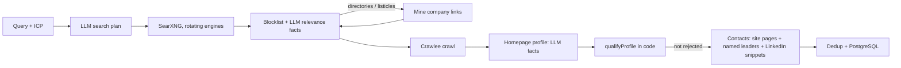

# GTM

GTM is a B2B go-to-market platform for finding companies and the people who run them from the open web, then turning that into prospect lists.

We are at **stage 1: the prospect finder** (`prospectEngine/`). Given a product profile (ICP) and a query, it finds matching companies, checks each one against the ICP, and extracts its decision-makers. Email verification, outreach and CRM come later, once finder quality meets the bar in the PRD.

## Ground rules

- **Built in-house.** AI APIs (OpenAI) are allowed. Search, data sources and crawling are our own: self-hosted SearXNG and our own Crawlee crawler. No paid or third-party search, data or fetch services (Jina stays off).
- **LinkedIn only through public data.** We store LinkedIn URLs found on company websites and read names and headlines from public search-result snippets. We never log in to LinkedIn or fetch its pages.
- **Respect sites.** robots.txt is honoured. Sites that block the crawler (HTTP 403) are skipped, not evaded.
- **The LLM returns facts, code decides.** Every approval or rejection is made by plain code and stored with a readable reason.

## How a run works



| Stage | Code | What it does |
| --- | --- | --- |
| Search plan | `discovery/queryGenerator.js` | LLM turns the query + ICP into short buyer-side queries ("business coaches Pune India") plus target location and company size. Queries never name the product the prospects use, so vendors of it are not surfaced. Falls back to templates without an LLM. |
| Search | `channels/search.js`, `sources/searxng/` | Each query goes to a rotating slice of SearXNG engines (`SEARXNG_ENGINES`, `SEARXNG_ENGINES_PER_QUERY`). Empty results are not cached. |
| Relevance | `relevance/companyRelevance.js`, `relevance/blocklist.js` | Blocklist and listicle titles first, then one LLM call per batch of domains. The LLM returns facts (company website?, matches the plan?, sells what the target needs?, large enterprise?) and `decideFromFacts` approves, rejects or sends to review. |
| Directory mining | `sources/public/index.js` | Rejected directory and listicle pages are crawled for the company websites they link to, which then go through relevance. The same collector powers the per-product public source harvest. |
| Crawl | `crawl/crawlers.js` | Crawlee `CheerioCrawler` with sitemap and internal-link discovery, robots.txt, rate limits and retries. |
| Company profile | `extraction/companyExtractor.js` | One record per domain. The LLM reads the homepage plus up to two about/services pages and returns name, business type, what they sell, B2B/B2C, country, size bucket, operating company or not, matching ICP types, named leaders, and supporting quotes. Quotes and people not actually on the page are dropped. |
| Qualification | `qualification/qualify.js` (`qualifyProfile`) | Code decides `qualified` / `review` / `not_qualified` from those facts: location, size limit, B2B, ICP type, operating company. Any unknown goes to review. |
| Contacts | `parse/`, `pipeline.js` | For companies not rejected: people from team/about/contact pages, LinkedIn links on the site, leaders named in the profile step, and (if the site lists nobody) `site:linkedin.com/in` search snippets. Strict name and job-title checks keep headings, taglines and service lists out. |
| Dedup | `parse/contact.js`, `dedup/crossSource.js` | Within a company, contacts merge transitively on personal email, unique phone, first + last name, or profile URL. Shared phones and role emails never merge people. Across companies, name matches only become review candidates. |
| Storage | `storage/` | PostgreSQL: `raw_pages`, `raw_records` (with `run_id`, `qualification_status`, `qualification_reasons`), `crawl_targets`, `product_sources`. |

## Status

Done (see the "Stage 1" section of the PRD for detail):

- Multi-engine search with rotation, LLM search planning, directory mining
- Vendor and enterprise filtering at relevance
- One profile per company with fact-based qualification
- Contact quality fixes, LinkedIn URLs from public sources, leader extraction, dedup fixes
- Dashboard (`prospectEngine/dashboard`, Vite + React) for running the finder and browsing companies and people

Open:

- Draft eval labels in `prospectEngine/test/fixtures/domains.csv` need a human check, then wiring into `npm run test:eval` with saved inputs so precision is measured the same way every run.
- Tests write to the dev database (the `acmecontact.com` fixture people). They need their own database.
- Free search engines rate-limit after many runs in a row; runs recover after a pause.
- Playwright fallback for JavaScript-only sites is deferred (about 1 page in 300 needed it).
- Product question: are LinkedIn or social-media agencies LinkAssist prospects? They are currently labelled `vendor`.

## Tech stack

| Layer | Technology |
| --- | --- |
| Runtime | Node.js 22 (ESM, JavaScript) |
| Database | PostgreSQL 16 (`pg`) |
| Queue | Redis 7 + BullMQ |
| Search | Self-hosted SearXNG (`prospectEngine/searxng/settings.yml`) |
| Crawling | Crawlee `CheerioCrawler` |
| LLM | OpenAI (`OPENAI_MODEL`, currently `gpt-4.1`) for planning, relevance and company profiles |
| Dashboard | Vite + React + Tailwind |

## Running locally

Docker Compose brings up Postgres, Redis, SearXNG, migrations, the API and the worker:

```bash
cd prospectEngine
docker compose up -d --build
docker compose --profile ui up -d dashboard   # dashboard on http://localhost:5173
```

After changing backend code, rebuild the API and worker (`docker compose up -d --build api worker`), since their images contain the source.

Without Docker for the app (still needs Postgres and SearXNG running):

```bash
cd prospectEngine
npm install
npm run migrate
npm start          # one CLI run of USER_QUERY, prints companies and contacts for this run
npm run api        # HTTP API on :3000
npm run worker     # BullMQ worker
```

Tests: `test:parse`, `test:company`, `test:contact`, `test:dedup`, `test:discovery`, `test:relevance`, `test:eval`, `test:api`, `test:health`.

## Environment variables

Set in `prospectEngine/.env` (never commit it):

| Variable | Purpose |
| --- | --- |
| `USER_QUERY` | Query for CLI runs |
| `DATABASE_URL` / `DB_*` | PostgreSQL connection |
| `REDIS_ENABLED`, `REDIS_*` | Queue connection |
| `SEARXNG_URL`, `SEARXNG_ENGINES`, `SEARXNG_ENGINES_PER_QUERY`, `SEARXNG_QUERY_DELAY_MS` | Search endpoint, engine pool, engines per query, pause between queries |
| `OPENAI_ENABLED`, `OPENAI_API_KEY`, `OPENAI_MODEL`, `RELEVANCE_ENABLED` | LLM for planning, relevance and profiles |
| `CRAWL_MAX_CANDIDATES`, `CRAWL_MAX_PAGES_PER_DOMAIN` | Companies crawled per run and pages per company |
| `CRAWLER_CONTACT_URL` | Contact page the crawler identifies itself with; set a real one |
| `JINA_ENABLED` | Keep `false` (third-party fetch service) |

## HTTP API

`GET /health`, `GET /ready`, `POST /finder` (query + ICP), `GET /jobs/:id`, `GET /dashboard`, `GET /index/search`, `GET|POST|DELETE /index/sources`, `POST /index/harvest`, `GET /search/diagnostic`, plus the older `POST /discover`, `/crawl`, `/extract`.

## Project structure

```text
GTM/
├── README.md
├── Prospect Engine — Quality Fixes PRD & Dev Plan.md   # quality plan and stage 1 progress
└── prospectEngine/
    ├── dashboard/      # Vite + React dashboard
    ├── searxng/        # SearXNG engine settings
    ├── src/
    │   ├── api/            # HTTP API
    │   ├── bin/            # api and worker entry points
    │   ├── channels/       # search backend with engine rotation
    │   ├── crawl/          # Crawlee crawler, sitemap and link discovery
    │   ├── dedup/          # cross-source person dedupe
    │   ├── discovery/      # search planning, search rounds, directory mining
    │   ├── extraction/     # homepage company profile (LLM facts)
    │   ├── icp/            # product ICP definitions
    │   ├── jobs/           # BullMQ queues and processors
    │   ├── lib/            # names, URLs, logging
    │   ├── parse/          # page parsing and contact extraction
    │   ├── qualification/  # code-based qualification
    │   ├── relevance/      # blocklist and relevance decisions
    │   ├── sources/        # SearXNG source, LinkedIn snippets, public source harvest
    │   ├── storage/        # PostgreSQL access and migrations
    │   ├── finder.js       # finder job: discover → crawl → extract
    │   ├── index.js        # CLI single run
    │   └── pipeline.js     # extraction: company profiles, qualification, contacts
    └── test/
```
